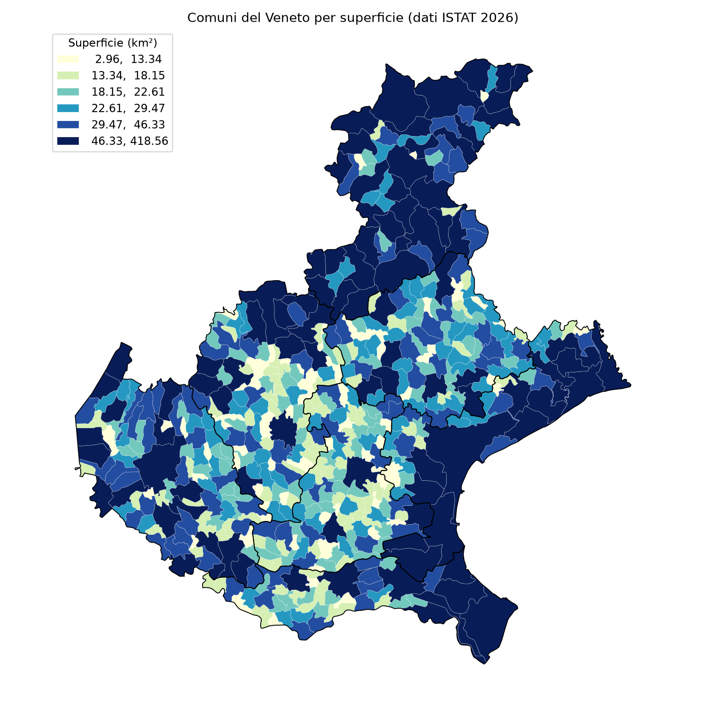
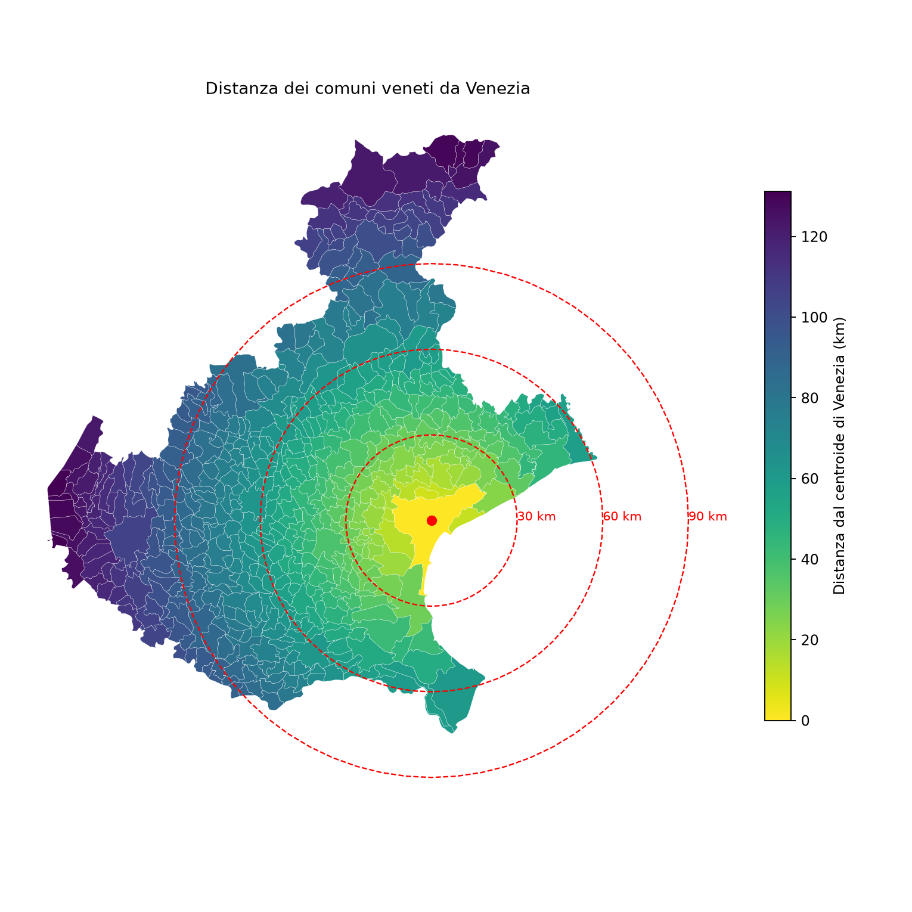

# I comuni del Veneto con GeoPandas

Esercizio di analisi geospaziale sui confini amministrativi ISTAT 2026 (licenza CC-BY 4.0), fatto durante il corso di Python per i dati geospaziali. Ha scopo dimostrativo.

## Output
- `output/mappa_superficie.png`: i 560 comuni per superficie
- `output/mappa_distanza_venezia.png`: distanza da Venezia, con anelli a 30, 60 e 90 km
- `output/comuni_veneto.geojson`: dati in WGS84
- `output/classifiche_comuni.csv` e `output/statistiche_province.csv`

## Uso
```
python -m pip install -r requirements.txt
python analisi_veneto.py
```
Al primo avvio scarica i confini ISTAT (circa 10 MB) in `data/`.

## Mappe





## Risultati
- Comuni entro 30, 60 e 90 km dal centroide di Venezia: 51, 255, 436
- Comune più esteso: Venezia (circa 419 km²); il più piccolo: Zermeghedo (circa 3 km²)

## Possibili sviluppi
Densità abitativa con i dati di popolazione ISTAT, altitudine media per comune da un DEM con rasterio, mappa interattiva.

Dati: ISTAT, Confini delle unità amministrative a fini statistici, https://www.istat.it/

## Licenza
Codice sotto licenza MIT. I dati ISTAT restano sotto CC-BY 4.0.
